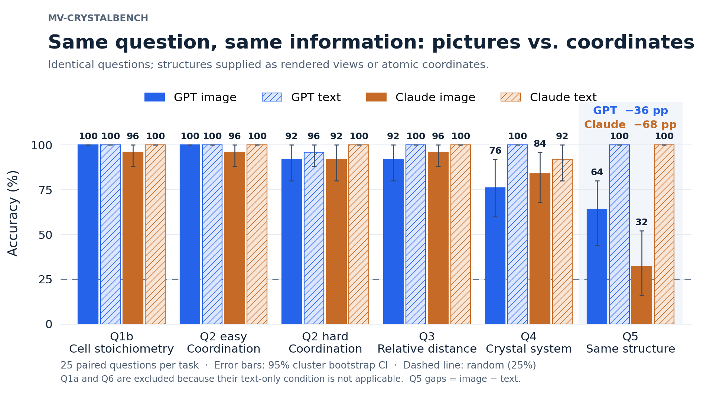
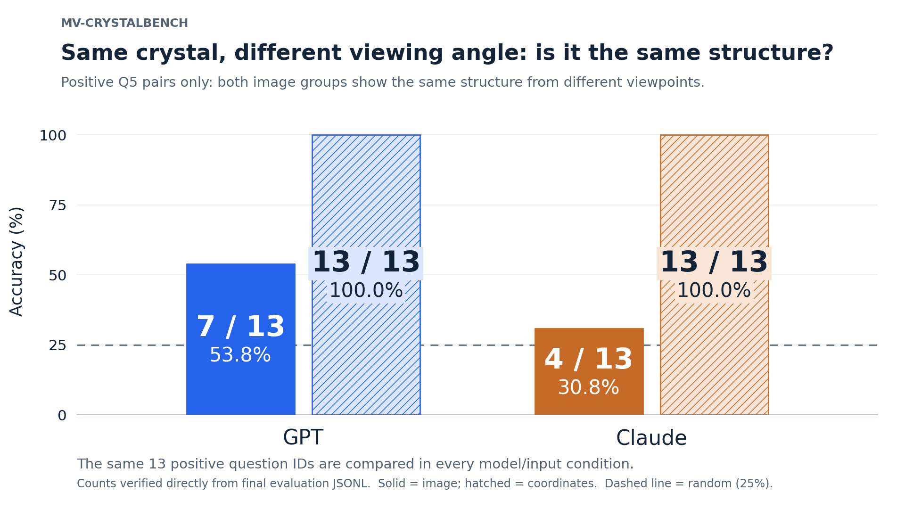
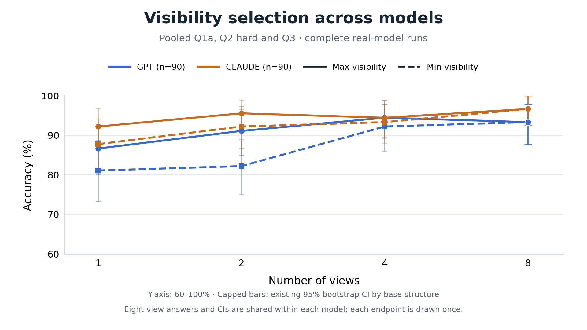
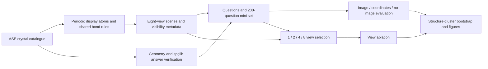

# MV-CrystalBench

[GitHub repository](https://github.com/Gambit-Checkmate/mv-crystalbench) · [Hugging Face dataset](https://huggingface.co/datasets/chessnash01/mv-crystalbench)

[](https://huggingface.co/datasets/chessnash01/mv-crystalbench)

**A multi-view crystal spatial-reasoning benchmark with programmatically verified answers.**

MV-CrystalBench tests whether vision-language models can count atoms, compare distances, identify coordination environments, and recognize the same periodic structure across different views. It contains **48 crystal structures across six crystal systems, 716 four-choice questions, and a balanced 200-question mini evaluation**. Structure generation, rendering, answer verification, and scoring run locally with ASE, spglib, NumPy, and matplotlib; no GUI or pymatgen is required.

Built during the October 21–22, 2026 OSI Hackathon. This is a small, controlled benchmark of idealized crystal renderings, not a claim that VLMs cannot understand all 3D materials.

Materials questions often require reconstructing spatial relationships from projections. Familiar chemical formulas and language priors can mask failures in that reconstruction. Comparing pictures, explicit coordinates, and questions alone helps separate these effects; varying the views tests how much visual access matters.



The image and text conditions ask identical questions. Text supplies lattice geometry and complete displayed-atom coordinates; images supply projections. They describe the same scene but are **not equivalent information representations**: coordinates make exact geometry directly available and avoid visual occlusion.

## Results

These are real model responses from the frozen final run. Entries are accuracy percentages with 95% confidence intervals; `n` is the number of scored questions.

| Model / baseline | Image, n=200 | Coordinates only, n=150 | Question + options only, n=200 |
| --- | ---: | ---: | ---: |
| GPT (`gpt-6.1-sol`, Nexfaro) | **89.0 [84.2, 93.2]** | **99.3 [97.9, 100.0]** | 28.5 [22.7, 34.0] |
| Claude (`claude-sonnet-5-5`, Heju) | **84.0 [77.6, 89.6]** | **98.7 [96.5, 100.0]** | 35.5 [28.1, 42.7] |
| Kimi (`kimi-k3`, Nexfaro) | N/A | N/A | N/A |
| Random choice, observed seeded run | 27.5 [23.0, 32.0] | 29.3 [22.9, 35.9] | 27.5 [22.6, 32.2] |

Random choice has a **theoretical expectation of 25%**, not exactly the observed finite-sample score. Q1a and Q6 have no applicable coordinate-only condition, so the text column excludes 50 questions. **Do not subtract the 200-question image column from the 150-question text column as a paired effect.** On the same 150 text-applicable question IDs, image accuracy is 87.3% for GPT and 82.7% for Claude; their paired image-minus-text gaps are −12.0 and −16.0 percentage points, respectively.

Intervals use 2,000 percentile bootstrap draws that resample whole `base_structure` clusters, with seed `20261021`. Paired contrasts use shared cluster resamples. API errors and invalid responses count as incorrect; explicitly inapplicable text items are excluded. Missing results are reported separately rather than silently scored. Sources: [main tables and intervals](results/main_tables_ci.csv), [detailed summary](results/main_summary.csv), and [paired findings](results/key_findings.txt).

### Four findings

1. **Exact coordinates are easier than rendered views on the matched cohort.** Image-minus-text accuracy is **−12.0 pp [−18.1, −6.7]** for GPT and **−16.0 pp [−22.4, −10.4]** for Claude, over the same 150 questions. This isolates a representation gap; it does not prove that visual and coordinate inputs contain equally accessible information.
2. **Cross-view structure identity is a clear failure case.** On Q5, image accuracy is **64.0% [44.0, 80.0]** for GPT and **32.0% [16.0, 52.0]** for Claude, versus 100% for both with coordinates. Image-minus-text gaps are −36 and −68 pp. For the 13 positive pairs that really are the same structure, raw counts are GPT **7/13** and Claude **4/13**, versus **13/13** for both with coordinates.
3. **More views help in the pooled ablation.** Across 90 questions per model, eight views improve on one random view by **+11.1 pp [1.3, 20.2]** for GPT and **+6.7 pp [1.1, 13.1]** for Claude. Q3 improvements are +20.0 pp [0.0, 36.7] and +16.7 pp [3.3, 33.3], respectively. These are endpoint comparisons, not evidence that every additional view or every task improves monotonically.
4. **The current visibility heuristic has no established overall advantage.** At one view, `max_visibility` minus `min_visibility` is **+5.6 pp [−3.3, 14.8]** for GPT and **+4.4 pp [−2.6, 12.2]** for Claude. Both pooled intervals contain zero. Visibility is a useful experimental variable, but this run does not establish it as a generally better view-selection policy.





For concrete failure examples, see [Q3 relative distance](figures/example_q3.png) and [Q5 structure identity](figures/example_q5.png). The [Q3 view-count figure](figures/ablation_q3.png) separates the distance task from the pooled result.

## Benchmark design

| Stratum | Full set | Mini set | Task and answer source |
| --- | ---: | ---: | --- |
| Q1a | 100 | 25 | Count displayed atoms of an element, including periodic boundary images. |
| Q1b | 100 | 25 | Count atoms assigned to one cell after boundary sharing; verify against the original cell. |
| Q2 easy | 60 | 25 | Coordination number in an isolated, complete local environment. |
| Q2 hard | 60 | 25 | Coordination number inside a cell or supercell with a complete displayed neighbor shell. |
| Q3 | 100 | 25 | Compare the actual 3D distances from A to B and C. |
| Q4 | 96 | 25 | Crystal system determined by spglib. |
| Q5 | 100 | 25 | Decide whether two groups of views depict the same structure. |
| Q6 | 100 | 25 | Identify a strict viewing direction among symmetry-inequivalent options. |
| **Total** | **716** | **200** | Four options, one correct answer per question. |

The catalogue contains 12 cubic, 8 hexagonal, 8 monoclinic, 8 orthorhombic, 6 tetragonal, and 6 trigonal structures. Q4 has 16 full-set questions per crystal system. The full set has exactly 179 correct answers at each of A/B/C/D; the mini set is approximately balanced. Each base structure contributes at most four questions per type, with at most two per Q2 difficulty. Mini sampling preserves Q1a/Q1b pairs and stratifies the relevant Q3–Q5 categories.



### Rendering and chemistry assumptions

- ASE's matplotlib renderer produces white-background, 512×512 PNGs with cell edges, bonds, element legends, depth ordering, and distance fog. Jmol colors are used unless the element or reserved-highlight separation fails the CIELAB ΔE ≥ 40 checks; a fixed contrasting palette then replaces them. Checks also account for common depth fog. Structure names and crystallographic labels are absent from benchmark images and anonymous scene filenames.
- `cell` shows the original cell plus periodic boundary images; `supercell` repeats it; `environment` contains a selected center and periodic neighbors. Each displayed atom maps to an original index and lattice translation. Visibility metadata estimates the unobscured projected disk area by rasterization.
- Bonding is an explicit benchmark convention. Each structure defines allowed element pairs. For each pair, the shortest nonzero periodic distance is `d_min`, and bonds satisfy `distance <= 1.10 * d_min`. Rendering and Q2 use the same implementation in [bonding.py](bonding.py). This is not a universal chemical bond definition. Nine structures with unsuitable or ambiguous shells are excluded from Q2; 39 remain eligible.
- Every scene has three tilted crystal-direction views, `[100]`, `[110]`, and `[111]` with `tilt=8°`, plus five seeded random directions with `tilt=0`. Random directions are sampled as lattice-basis coefficients, not uniformly over Cartesian directions in non-cubic cells. Q6 uses separately rendered strict directions with `tilt=0`.
- Q1a requires every counted atom to be at least 50% visible in one default view. Q2 centers and Q3 labels are selected for at least 70% visibility across all eight candidate views. Q2 hard additionally requires the entire periodic shell to exist in the display.
- Q3 uses displayed 3D Euclidean positions without minimum-image wrapping. Its distance difference is at least 15% of the larger distance. Half of full-set Q3 questions have `depth_trap=true`: the first default view reverses the 2D versus 3D distance ordering. This does not imply that all supplied views are misleading.
- Q5 has 50 positive and 50 negative full-set pairs. Negatives swap elements, delete an atom, stretch one lattice axis by 8%, or substitute a same-composition polymorph. Symmetry-equivalent element swaps are rejected. “Same structure” includes absolute lattice dimensions; deletion and polymorph changes are classified as different atomic arrangements. The two groups use different view directions.
- Q6 uses cubic direction families or non-cubic directions, and rejects questions whose options are equivalent under spglib symmetry operations.

The catalogue is constructed locally rather than downloaded during generation. Prototype sources, idealizations, and Q2 eligibility are recorded in [structures.py](structures.py) and [structure_catalog.py](structure_catalog.py); attribution is summarized in [THIRD_PARTY_NOTICES.md](THIRD_PARTY_NOTICES.md).

### Data format and release package

Each JSONL row has `id`, `qtype`, `difficulty`, `structure`, `scene_id`, `view_ids`, `image_paths`, `question`, `options`, `answer`, `answer_text`, `meta`, and `text_repr`. `structure`, answers, and internal metadata are never serialized into the model prompt. Q4 naturally includes candidate crystal systems in its options; it does not disclose the correct system in the background text.

`text_repr` lists lattice parameters/vectors and **all displayed atoms**, with elements, unwrapped fractional coordinates, and `[A]`/`[B]`/`[C]` markers. It contains no structure name, mineral name, space group, or crystal-system answer. Q1a and Q6 have empty text representations and `meta.text_applicable=false`. For Q5, both groups are described.

The Hugging Face-ready local package has this layout:

```text
hf_dataset/
  README.md
  questions.jsonl          # 716 rows, byte-identical to the frozen full set
  questions_mini.jsonl     # 200 rows, byte-identical to the frozen mini set
  images/
    scenes/<scene_id>/...  # 1,507 PNGs referenced by the released questions
```

Resolve each row's `image_paths` relative to **`hf_dataset/images`**, not `hf_dataset` itself. This compact package includes question-referenced images only. It **does not include every eight-view candidate or visibility metadata**, so it supports the released questions but cannot directly support view ablation. Regenerate complete scenes locally for that experiment. The package is hosted on [Hugging Face](https://huggingface.co/datasets/chessnash01/mv-crystalbench); it is excluded from Git. No dataset DOI has been assigned.

## Reproduce

Python 3.12 is recommended. Pinned dependencies are in [requirements.txt](requirements.txt). Run commands from the project root. Examples write to new `data_reproduced/` or `reproduced/` directories and preserve the frozen `data/`, `results/`, and `figures/` artifacts.

### 1. Install

```bash
python -m venv .venv
```

Activate with `source .venv/bin/activate` on Linux/macOS, or `.\.venv\Scripts\Activate.ps1` in Windows PowerShell, then:

```bash
python -m pip install -r requirements.txt
python structures.py
```

The last command prints a spglib space-group self-check for each structure; it does not render or call an API.

### 2. Check the released questions without an API

Download the public dataset package separately from the code repository:

```bash
python -m pip install huggingface_hub
python -c "from huggingface_hub import snapshot_download; snapshot_download('chessnash01/mv-crystalbench', repo_type='dataset', local_dir='hf_dataset')"
```

With the local release package present:

```bash
python evaluate.py --dry-run --questions hf_dataset/questions_mini.jsonl --data-dir hf_dataset/images --condition image --limit 8 --output reproduced/dry_run_image.jsonl
python evaluate.py --baseline random --questions hf_dataset/questions_mini.jsonl --data-dir hf_dataset/images --condition all --output reproduced/random.jsonl --seed 20261021
```

Dry-run simulates answers; it is a workflow check, not model evidence. `random` samples four answer letters uniformly. An optional `majority` baseline uses full-set answer-text frequencies within each task (Q2 split by difficulty), so it is a descriptive, label-informed baseline rather than a held-out training baseline:

```bash
python evaluate.py --baseline majority --questions hf_dataset/questions_mini.jsonl --full-questions hf_dataset/questions.jsonl --data-dir hf_dataset/images --condition image --output reproduced/majority_image.jsonl
```

### 3. Regenerate scenes and questions

```bash
python questions.py --preflight --target 100 --seed 20261021
python questions.py --out-dir data_reproduced --target 100 --seed 20261021
python audit_dataset.py --data-dir data_reproduced
python render.py --inspection --out-dir reproduced/render_review
```

Generation creates the full and mini JSONLs, `scenes.jsonl`, complete scene PNG/visibility JSON files, statistics, and `data_reproduced/review.html`. The audit independently checks answers, shells, visibility, pairing, and symmetry. Open the HTML in a browser for manual review. Fixed seeds control generation and selection; exact image bytes can still depend on library/font versions. Use frozen release data when comparing directly against the published run.

### 4. Configure and evaluate a model

Copy the public configuration template without copying any private credentials:

```bash
python -c "import shutil; shutil.copyfile('models.example.yaml', 'models.yaml')"
```

Edit your local, git-ignored `models.yaml`. Set the endpoint, requested model ID, and `api_key_env` to the **name of an environment variable you choose**, then set that variable in your shell. Keep the API key itself out of YAML, source code, and version control. Example aliases include `gpt`, `claude`, `kimi`, and `local_vllm`; availability depends on the endpoint you configure. Evaluation uses an OpenAI-compatible chat-completions interface with multiple images, or a labelled contact sheet for endpoints without multi-image support.

Start with eight requests, then choose a fresh output path for a complete run:

```bash
python evaluate.py --config models.yaml --model gpt --questions hf_dataset/questions_mini.jsonl --data-dir hf_dataset/images --condition image --limit 8 --output reproduced/gpt_smoke.jsonl --concurrency 8 --timeout 300 --max-retries 1
python evaluate.py --config models.yaml --model gpt --questions hf_dataset/questions_mini.jsonl --data-dir hf_dataset/images --condition image --output reproduced/gpt_image.jsonl --concurrency 8 --timeout 300 --max-retries 1
python evaluate.py --config models.yaml --model gpt --questions hf_dataset/questions_mini.jsonl --data-dir hf_dataset/images --condition text --output reproduced/gpt_text.jsonl --concurrency 8 --timeout 300 --max-retries 1
python evaluate.py --config models.yaml --model gpt --questions hf_dataset/questions_mini.jsonl --data-dir hf_dataset/images --condition no_image --output reproduced/gpt_no_image.jsonl --concurrency 8 --timeout 300 --max-retries 1
```

Repeat with `--model claude` and distinct output filenames after configuring that endpoint. These commands make real, potentially billable requests. The final study used a generation-token cap of 8,192, concurrency 8 per model, a 300-second socket timeout, and at most one retry. GPT requested temperature 0; Claude omitted temperature as required by its endpoint. `image+text` is supported but was **not part of the final three-condition comparison**. `--condition all` includes all four supported conditions, including `image+text`.

| Condition | Supplied information | Mini scored count |
| --- | --- | ---: |
| `image` | Images, question, options | 200 |
| `text` | Complete coordinate representation, question, options | 150 |
| `no_image` | Question and options only; no images or coordinates | 200 |
| `image+text` | Images and coordinates, question, options | 200 |

Results append and flush per question. Resume skips all recorded outcomes, including errors and invalid outputs; use a **new output file** to deliberately retry failed requests. Dataset/configuration fingerprints prevent incompatible runs from sharing a file. Raw responses, parsed choices, returned model IDs, usage where supplied, latency, finish reasons, and errors remain available for inspection. Responses must end with `Answer: A`, `Answer: B`, `Answer: C`, or `Answer: D`; unparsable answers count as incorrect.

`run_final.py` preserves the original study orchestration and its fixed artifact locations. Use the explicit commands above for new runs so that frozen release results remain intact.

### 5. Reproduce the view ablation

Use the **regenerated complete scene directory**, not the compact image release. This dry-run performs no API calls:

```bash
python ablation.py --dry-run --questions data_reproduced/questions.jsonl --scenes data_reproduced/scenes.jsonl --data-dir data_reproduced --per-type 30 --seed 20261021 --output reproduced/ablation_dry_run.jsonl --cache-output reproduced/cache/ablation_dry_run.jsonl --figures-dir reproduced/figures_dry_run
```

For a real run after a successful smoke test:

```bash
python ablation.py --config models.yaml --model gpt --questions data_reproduced/questions.jsonl --scenes data_reproduced/scenes.jsonl --data-dir data_reproduced --per-type 30 --seed 20261021 --output reproduced/ablation_gpt.jsonl --cache-output reproduced/cache/ablation_gpt.jsonl --figures-dir reproduced/figures_gpt --concurrency 8 --timeout 300 --max-retries 1
```

This samples 30 questions each from Q1a, Q2 hard, and Q3, then compares `k = 1, 2, 4, 8` for `random`, `canonical`, `max_visibility`, and `min_visibility`: 1,440 combination records per model. Random subsets are deterministic per question and k, without forced nesting. Canonical uses the fixed candidate order; maximum/minimum visibility greedily maximize/minimize

```text
S(selected views) = sum over relevant atoms of max visibility across selected views
```

The selector receives visibility values, not answers or correctness. Relevant atoms come from the question's referenced element, highlights, or the shared bond graph. All strategies use the **same eight-view endpoint**; identical requests are cached and reused. The shared endpoint is not four independent observations. Binned visibility plots are descriptive associations, not causal evidence.

### 6. Summarize a new run

```bash
python summarize.py --input reproduced/gpt_image.jsonl reproduced/gpt_text.jsonl reproduced/gpt_no_image.jsonl --questions hf_dataset/questions_mini.jsonl --models gpt --conditions image text no_image --output reproduced/main_summary.csv --main-tables reproduced/main_tables.txt --bootstrap 2000 --seed 20261021
python findings.py --input reproduced/gpt_image.jsonl reproduced/gpt_text.jsonl reproduced/gpt_no_image.jsonl --ablation reproduced/ablation_gpt.jsonl --questions hf_dataset/questions_mini.jsonl --models gpt --conditions image text no_image --output reproduced/key_findings.txt --ablation-per-type 30 --bootstrap 2000 --seed 20261021
python -m unittest discover -v
```

The summary command also writes detailed main-table CSV files beside its requested output. Tests use local fixtures/mocks and do not require paid model requests.

## Limitations and provenance

- **Small, curated sample.** The mini set has only 25 questions per stratum and shares base structures across tasks. Cluster bootstrap accounts for that grouping but cannot establish performance on unseen chemistry or experimental microscopy. A 100% estimate or an interval endpoint of 100% is not a guarantee of generalization. Comparisons are descriptive, with no multiple-comparison correction.
- **Answer priors and distractor shortcuts remain.** Q1a's numeric distractors contain guessable patterns. Claude scores **56% [36%, 76%] on Q1a with no image**, indicating exploitable question/option priors despite answer-letter balancing. Q1b can benefit from familiar stoichiometries and conventional-cell knowledge. High accuracy on these tasks need not reflect faithful 3D reconstruction. GPT's no-image run has 34 unparsable responses, counted as wrong.
- **Coordinates are a stronger access channel.** Text exposes complete positions and periodic-image information, while projections can occlude atoms. Near-perfect text scores do not establish a pure chemical-knowledge ceiling or an information-equivalent visual/text experiment.
- **Rendering and chemistry are controlled simplifications.** These are idealized prototypes with finite displays, orthographic renderings, explicit color legends, and a fixed pair-specific bonding rule. They do not cover arbitrary CIFs, defects, thermal motion, disorder, all chemically valid coordination definitions, or all crystal systems. Catalogue assumptions and excluded Q2 cases remain part of the benchmark specification.
- **Depth-trap evidence is limited.** For image Q3, trap-minus-non-trap accuracy is −0.6 pp [−23.1, 21.4] for GPT and −8.3 pp [−27.3, 0.0] for Claude. This mini sample does not establish a robust general depth-trap penalty, even though individual failures are inspectable.
- **Only two endpoints completed the formal study.** Kimi's final eight-question smoke test produced five valid responses and three upstream HTTP 502 errors after retries. Under the smoke-failure rule it was excluded from the main evaluation and ablation. Its score is **N/A, not zero**; an endpoint failure is not a model-capability result.
- **Third-party routing limits identity claims.** GPT and Claude were accessed through Nexfaro and Heju. Requested and returned model strings matched in successful formal responses, but returned IDs are provider-supplied metadata, **not independent verification of model identity or version**. Results should be attributed to these tested routes and configurations, not assumed to reproduce a vendor's direct API.
- **Diagnostics are excluded from accuracy results.** Earlier pilots and lower-token-cap diagnostics are not in the final tables. Claude's formal ablation includes one empty, length-limited response, scored as incorrect. Image and text main runs had no invalid outputs or API errors for either included model. No formal cohort was reduced for cost; historical attempts remain separate from the final accuracy analysis.

## Repository map

| Files | Purpose |
| --- | --- |
| `structures.py`, `structure_catalog.py`, `bonding.py` | Crystal catalogue, provenance, periodic neighbors, shared bond rules. |
| `render.py`, `scenes.py` | Headless rendering, display mappings, visibility, reusable scene sets. |
| `questions.py`, `question_*.py`, `audit_dataset.py` | Question generation and independent local validation. |
| `evaluate.py`, `models.example.yaml` | Configurable evaluation, offline baselines, resume support. |
| `ablation.py`, `ablation_plots.py` | View selection, request deduplication, ablation summaries. |
| `summarize.py`, `findings.py` | Accuracy tables and paired structure-cluster intervals. |
| `data/`, `results/`, `figures/` | Frozen generation artifacts, formal results, and presentation figures. |
| `hf_dataset/` | Compact dataset package containing questions and referenced images. |

## License and citation

Project code is released under the [MIT License](LICENSE). Project-authored benchmark questions, rendered images, and associated dataset metadata are released under [CC BY 4.0](LICENSE-DATA). Dependencies and external prototype references retain their own terms; see [THIRD_PARTY_NOTICES.md](THIRD_PARTY_NOTICES.md).

If you use this benchmark, please cite:

```bibtex
@misc{mvcrystalbench2026,
  author = {{MV-CrystalBench contributors}},
  title = {{MV-CrystalBench}: A Multi-View Crystal Spatial-Reasoning Benchmark},
  year = {2026},
  url = {https://github.com/Gambit-Checkmate/mv-crystalbench},
  note = {OSI Hackathon benchmark and software}
}
```

No paper DOI has been assigned to this release.
